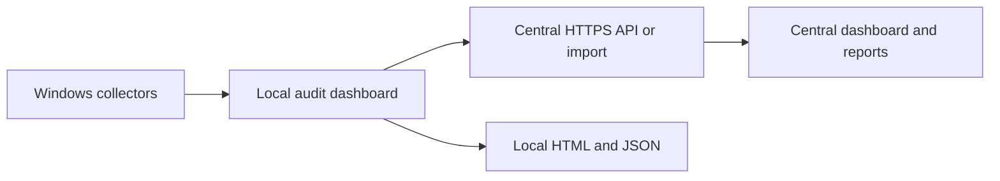

# EndpointLens

Automated IT Security Audit System for Windows Endpoints  
Joey Low Yan Hui · FYP prototype

## Quick start on a Windows 10 or 11 x64 computer

1. See the release’s START-HERE.md for the managed login workflow. Extract the portable ZIP and double-click **EndpointLens.exe**, including when running from a USB drive. No separate .NET installation is needed on the audited computer.
2. The local dashboard opens in your normal browser. Sign in as Admin if the EXE is configured for the central website. In offline-only mode create a local account on first use. Keep the EndpointLens console open while using the dashboard.
3. Select **Start audit** from Overview. When the results appear, use the tabs to review evidence and select **Download HTML** for the report.
4. Use **Export snapshot** if you will import it into the central dashboard later. **Export report JSON** includes findings, scoring and evidence for archival or analysis. The two JSON formats serve different purposes.
5. To end the local session, press **Ctrl+C** in the EndpointLens console or close the window.

**Administrator permissions.** The standard-user audit still collects accessible evidence. To collect checks that require elevation, close EndpointLens and open the EXE with **Run as administrator**. If Windows requests the credentials of a different account, the new process may use that account's local dashboard and per-user application registry. The interactive user value is separately recorded as a console-session snapshot.

Local history is saved under `%LOCALAPPDATA%\EndpointLens\Dashboard\local.db`. The browser downloads HTML and JSON to its normal download location. Carry the EXE and any selected reports on USB.

## What it collects

| Category | Examples |
| --- | --- |
| Hardware and Windows | Computer name, Windows edition/build, computer model, CPU, physical drive model/type/size, RAM total and module manufacturer/part number/capacity |
| Installed software | Names and versions from Windows uninstall registry entries |
| Current user | Interactive console user, separately from the process account |
| Local accounts | Status, local Administrators membership and local password policy |
| Antivirus | Registered product names and documented Defender health/status where readable |
| Firewall | Domain, Private and Public profiles, with source and service state |
| Selected settings | UAC, SMBv1, Remote Desktop/NLA and system-drive BitLocker |

Blank or inaccessible fields depend on the PC, hardware firmware, Windows edition and privileges. Third-party antivirus registration is evidence of registration. The current collector has no vendor-specific health integration for products such as Avira. See [rule catalogue](docs/RULES.md) for the 11 versioned checks, applicability, score and coverage.

## Build from source

Install the .NET 10 SDK on the development computer. From the project folder in PowerShell:

```powershell
dotnet test EndpointLens.sln
.\Publish-Portable.ps1
```

Copy `publish\portable\EndpointLens.exe` to the USB drive. The packaged app includes Razor views, styling and the .NET runtime. It is an unsigned x64 build. Managed Windows devices can require administrator approval or code signing before they allow USB executables.

## Central Dashboard and Admin login

The ordinary EXE launch opens the local dashboard. Launching with `--server` starts the separate central website. In managed mode the local sign-in uses the audit operator credentials, and the central website uses its own Super Admin account. Set a different password for each.

To test on one PC, see `START-HERE.md` at the top of the release ZIP. The launcher wraps these PowerShell commands, run from the release root with the existing trusted development certificate:

```powershell
$cert = Join-Path $env:LOCALAPPDATA 'EndpointLens\certs\localhost.pfx'
New-Item -ItemType Directory -Force (Split-Path $cert) | Out-Null
$certPassword = [guid]::NewGuid().ToString('N')
dotnet dev-certs https --export-path $cert --password $certPassword --trust
if ($LASTEXITCODE -ne 0) { throw 'HTTPS certificate export failed.' }
$env:Kestrel__Certificates__Default__Path = $cert
$env:Kestrel__Certificates__Default__Password = $certPassword
$env:ASPNETCORE_URLS = 'https://localhost:5443'
$env:AuditOperator__UserName = 'audit-admin'
$secret = Read-Host 'Audit operator password (12 or more characters)' -AsSecureString
$env:AuditOperator__Password = [System.Net.NetworkCredential]::new('', $secret).Password
$exe = (Resolve-Path '.\EndpointLens.exe').Path
Set-Location .\Source
& $exe --server
```

For additional PCs, host the central instance on a reachable HTTPS name. Configure the Kestrel HTTPS endpoint and its certificate with the central host name in its SAN, and trust the issuing certificate on audit PCs. Set the same `Company:CentralAddress` in the appsettings.json distributed beside the common EXE. Keep `AuditOperator__UserName` and `AuditOperator__Password` in central deployment configuration only. The endpoint sign-in exchanges the operator credentials for a scoped submission credential held in memory. Its HTTPS API is rate limited.

The central site automatically associates the hashed Windows machine identity with the endpoint on Admin sign-in. It preserves that endpoint's history on subsequent sign-ins. Copied VM images should have distinct Windows machine identities. **Delete** on the central Overview permanently removes the chosen endpoint and its central audits and findings after confirmation. A future authorized Admin sign-in can register the computer again.

The local dashboard binds only to 127.0.0.1. Network sign-in and submission use HTTPS with certificate validation. The audit operator credentials grant no central Dashboard access. Keep a backup of your previous central database before moving it. Preserve the previous server's working directory or set `ConnectionStrings__Default` to the existing SQLite file to retain your central records.

## Architecture and data



Both dashboard modes share the same validator and rule engine. Local collection is read-only against Windows settings. Each mode has its own SQLite database. Central storage defaults to `endpointlens.db`; set `ConnectionStrings__Default` to an absolute data path for deployment. The central workflow uses four main tables. The local dashboard also stores its automatic upload queue.

| Table | Key relationships |
| --- | --- |
| AdminUsers | Unique username, password hash and login lockout state |
| Endpoints | Unique enrolled name, scoped credential hash, one-to-many audit history |
| Audits | Endpoint foreign key, globally unique SnapshotId, inventory JSON and evaluation summaries |
| Findings | Audit foreign key, rule/version, severity, outcome, evidence and recommendation |
| AuditUploads | Local queue, keyed to its saved audit and pinned to the enrolled central destination |

Use a fresh database for this project if you are coming from V1–V3. Their old reports and payload schemas differ. Preserve historical files separately. The V4 snapshot import format is carried forward. Reports record the rule set evaluated by the receiving instance.

## Evaluation

The test project includes synthetic rule cases and central API/dashboard tests. The Windows lab evaluation is a separate step. On three Windows PCs or VMs, run each audit three times and compare results with manually inspected settings. Save the rule outcomes, exact-match inventory results, end-to-end time, operator time and automated collection time. For failed network submission, export and import the same snapshot, then verify deduplication. Use the same report content and checklist to compute median manual versus automated completion times. The 30% improvement remains the project target until measured.

## Packaging choice

The FYP delivers a self-contained portable EXE for on-demand USB audits. MSIX is an optional installer distribution format for environments that want centralized app installation and updates. Packaging does not change which evidence Windows makes available. An MSIX variant would require signing and testing on the target devices, including the audit paths that need elevation.

## Source layout

- `src/EndpointLens.Server` — Windows collectors, local/central Razor UI, HTTPS API, SQLite, reports
- `src/EndpointLens.Core` — snapshot schema, validation, rules and scoring
- `tests/EndpointLens.Tests` — synthetic rule, validation, API and dashboard cases
- `docs/COMPARISON.md` — review of the four source versions and merge decisions
- `docs/RULES.md` — baseline and evidence caveats
